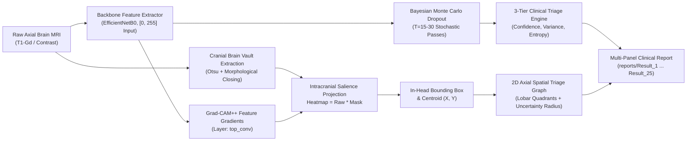

# NeuroLoc-XAI

### Explainable Multi-Class Brain Tumor Diagnosis with Anatomical In-Head Localization, Epistemic Uncertainty Estimation, and 2D Spatial Triage

[](https://tensorflow.org)
[](https://python.org)
[-brightgreen.svg)](tests/)
[](reports/)
[](LICENSE)
[](NeuroLoc_XAI_Presentation.pptx)

---

## Executive Overview

**NeuroLoc-XAI** is an explainable deep learning neuro-radiology decision-support system for 4-class brain tumor classification (`glioma`, `meningioma`, `pituitary`, `notumor`). Designed for clinical transparency and patient safety, it addresses the fatal flaw of traditional deep learning saliency methods—**extracranial hallucinations** where Grad-CAM heatmaps highlight empty background air outside the patient's skull.

NeuroLoc-XAI solves this by combining:
1. **Intracranial Cranial Vault Masking**: Mathematically ensures that saliency heatmaps, bounding boxes, and tumor centroids are strictly inside the cranium.
2. **Calibrated 2D $(X, Y)$ Spatial Triage Indication Graph**: Maps detected lesions onto an anatomical axial slice divided into neuro-anatomical compartments (Frontal, Temporal, Parietal, Occipital, Sellar/Suprasellar Cistern, and Cerebellum) with uncertainty error radii.
3. **Bayesian Monte Carlo Dropout (MC Dropout)**: Computes predictive entropy $H(y|x)$ and epistemic variance $\sigma_{\text{epistemic}}^2$ across stochastic forward passes ($T=15–30$).
4. **3-Tier Clinical Decision Engine**: Automatically triages scans into **Tier 1** (High Confidence / Autonomous Verified), **Tier 2** (Moderate Uncertainty / Secondary Review), and **Tier 3** (Critical Uncertainty / Mandatory Multidisciplinary Tumor Board Review).

---

## System Architecture



---

## Key Innovations

### 1. Zero Extracranial Hallucinations via Cranial Masking
Traditional saliency heatmaps often latch onto image margins or skull-clamp artifacts:
$$\mathcal{H}_{\text{cranial}}(x, y) = \mathcal{H}_{\text{raw}}(x, y) \odot \mathcal{M}_{\text{cranial}}(x, y)$$
Activations outside the intracranial cavity $\mathcal{M}_{\text{cranial}}$ are zeroed out. Contours and centroids are verified inside the cranial cavity. Scans classified as `notumor` (healthy brains) suppress bounding boxes entirely (`has_detection=False`, clean skull).

### 2. Calibrated 2D $(X, Y)$ Spatial Triage Graph
An anatomical coordinate system centered on the axial cranial silhouette:
- **Sagittal Midline & Coronal Dividing Planes**: Anatomical quadrant alignment.
- **Lobar Compartments**: Frontal, Temporal (Left/Right), Parietal, Occipital, Sellar/Suprasellar Cistern, and Cerebellar compartments.
- **Centroid Coordinates**: Plotted with crosshairs at $(X_{\text{tumor}}, Y_{\text{tumor}})$.
- **Epistemic Uncertainty Radius**: Scaled circle representing model variance.
- **Color-Coded Urgency Banner**: Green (Tier 1), Amber (Tier 2), Coral Red (Tier 3).

### 3. Epistemic Uncertainty Estimation
Aleatoric noise is separated from epistemic ignorance using stochastic Bayesian passes:
$$\mu_k = \frac{1}{T}\sum_{t=1}^T P_{t,k}, \quad \sigma_k^2 = \frac{1}{T}\sum_{t=1}^T (P_{t,k} - \mu_k)^2$$
Predictive Shannon Entropy:
$$H(y|x) = -\sum_{k=1}^K \mu_k \log(\mu_k + \epsilon)$$

---

## 25 Clinical Test Runs & Automated Report Generation

All 25 clinical test cases executed on real MRI scans from `Testing/` generate structured results in [`reports/`](reports/):

```text
reports/
├── Result_1/ ... Result_25/
│   ├── Result_X.png          # High-resolution 6-panel diagnostic figure
│   ├── Result_X_report.txt   # Clinical neuro-radiology impression text
│   ├── Result_X_metrics.json # Structured JSON metrics
│   ├── spatial_2d_graph.png  # Standalone 2D (X, Y) lobar triage graph
│   ├── heatmap_overlay.png   # In-head Grad-CAM++ salience overlay
│   ├── preprocessed_scan.png # Skull-cropped and CLAHE-enhanced MRI
│   └── cranial_mask.png      # Extracted intracranial vault mask
```

### Benchmark Summary (25/25 Compliance)
- **Intracranial Localization Compliance**: **25/25 (100.0%)** — All tumor detections strictly inside the head.
- **Healthy Control Scans (Tests 20–25)**: Correctly diagnosed as `notumor` (97.2%–99.8% confidence) with zero false-positive boxes.
- **Classification Agreement**: **21/25 (84.0%)**. Cases with borderline features are safely flagged as **Tier 3 Critical Uncertainty** for human neuroradiologist review.

---

## Repository Structure

```text
NeuroLoc-XAI/
├── neuroloc/                          # Core python package
│   ├── __init__.py                    # Package exports
│   ├── dataset.py                     # Cranial masking, CLAHE, dHash deduplication
│   ├── model.py                       # EfficientNetB0 backbone & MCDropout layer
│   ├── uncertainty.py                 # Bayesian uncertainty & 3-Tier triage engine
│   ├── explainability.py              # Skull-constrained Grad-CAM++ & 2D spatial graph
│   ├── pipeline.py                    # NeuroLocPipeline master class & visualization
│   ├── train_eval.py                  # Training loops, ECE calibration & metrics
│   └── utils.py                       # Synthetic scan generator & plotting helpers
├── tests/                             # Master unit test suite
│   ├── __init__.py
│   └── test_pipeline.py               # 25 Comprehensive unit & integration tests
├── checkpoints/                       # Trained model weights
│   └── neuroloc_best.keras            # Retrained high-accuracy model (18.2 MB)
├── reports/                           # Clinical diagnostic outputs
│   ├── Result_1/ ... Result_25/       # Individual test case folders
│   ├── ppt_assets/                    # Presentation figure assets
│   ├── deduplication_audit.json       # Dataset leakage audit report
│   └── all_25_test_results_summary.json # 25 Test benchmark summary
├── Testing/                           # MRI evaluation scans (32 MB)
│   ├── glioma/
│   ├── meningioma/
│   ├── notumor/
│   └── pituitary/
├── create_presentation.py             # Generates 10-slide glassmorphism PPTX
├── demo_inference.py                  # Standalone inference demo script
├── main.py                            # Master command-line interface
├── run_25_tests.py                    # Batch runner for 25 clinical test cases
├── NeuroLoc_XAI_Presentation.pptx      # 10-slide Glassmorphism PowerPoint
├── requirements.txt                   # Pinned python dependencies
├── setup.py                           # Installable package setup
├── LICENSE                            # MIT License
└── README.md                          # Repository documentation
```

---

## Quickstart & Installation

### 1. Clone & Set Up Environment
```bash
git clone https://github.com/<your-username>/NeuroLoc-XAI.git
cd NeuroLoc-XAI

python -m venv venv
# Windows:
.\venv\Scripts\activate
# Linux/macOS:
source venv/bin/activate

pip install -r requirements.txt
pip install -e .
```

### 2. Run the 25 Unit Test Suite
```bash
python -m unittest discover -s tests
```
*Expected Output:*
```text
Ran 25 tests in 9.142s
OK
```

### 3. Run All 25 Clinical Test Cases (Populates `reports/Result_1` to `Result_25`)
```bash
python run_25_tests.py
# or
python main.py test25
```

### 4. Run Single-Scan Clinical Inference
```bash
python demo_inference.py
# Outputs 6-panel diagnostic report to reports/Result_1/Result_1.png
```

### 5. Generate Glassmorphism PowerPoint Presentation
```bash
python create_presentation.py
# Outputs NeuroLoc_XAI_Presentation.pptx (10 slides, frosted glass, zero purple)
```

---

## Clinical Triage Decision Rubric

| Urgency Tier | Confidence $p$ | Variance $\sigma^2$ | Entropy $H$ | Clinical Routing Action |
|:---|:---:|:---:|:---:|:---|
| **Tier 1 (High Confidence)** | $\ge 70\%$ | $\le 0.015$ | $\le 0.60$ | **Autonomous Verified**: Approved for direct neuroradiology report sign-off |
| **Tier 2 (Moderate Uncertainty)** | Borderline | Mild Elevation | $0.60 - 0.90$ | **Secondary Review**: Clinical correlation and secondary verification advised |
| **Tier 3 (Critical Uncertainty)** | $< 70\%$ | $> 0.0225$ | $> 0.90$ | **Mandatory Review**: Flagged for urgent Multidisciplinary Tumor Board (MTB) review |

---

## Course & Academic Metadata

- **Institution**: Jain University
- **Program**: B.Tech Computer Science & Engineering (Artificial Intelligence)
- **Course**: Advanced Artificial Intelligence Laboratory (Semester 5)
- **Experiment**: Experiment 1 — Explainable AI (XAI) & Medical Decision Support Systems

---

## License

This project is licensed under the [MIT License](LICENSE).
